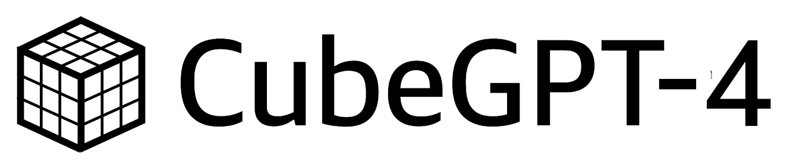
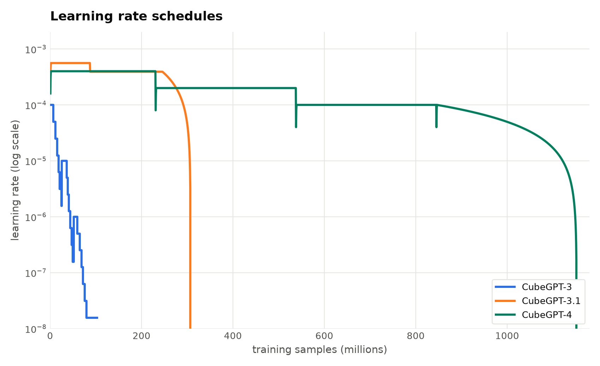
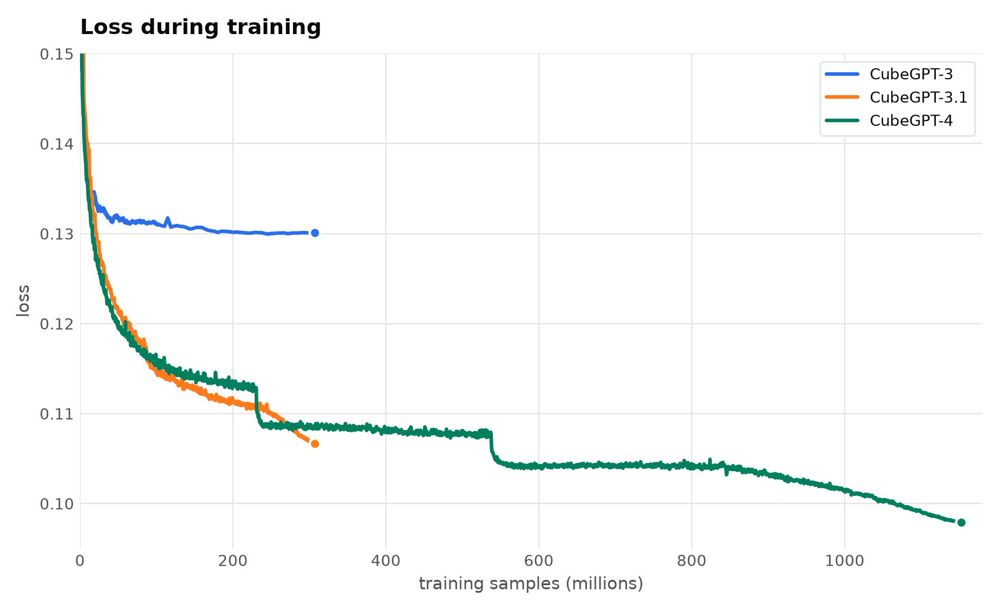
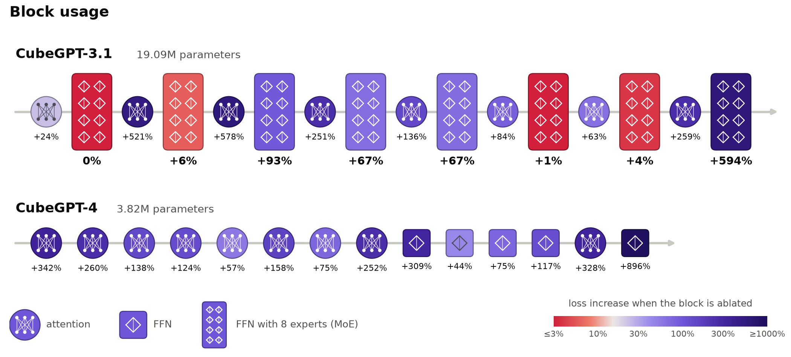
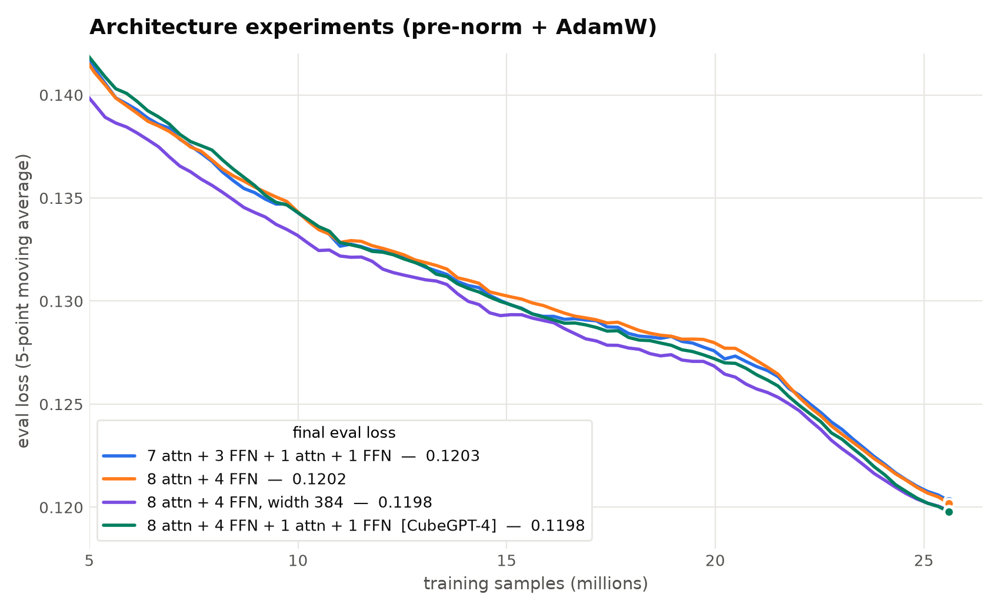
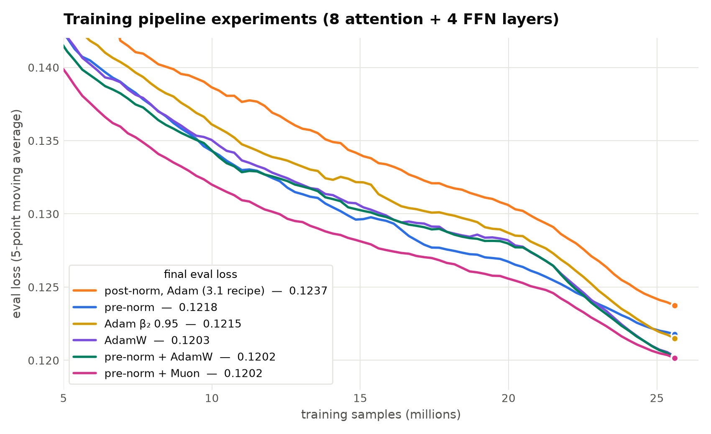
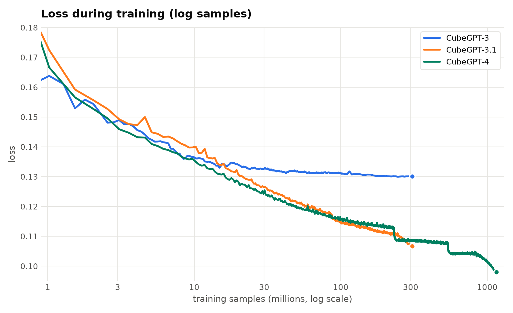
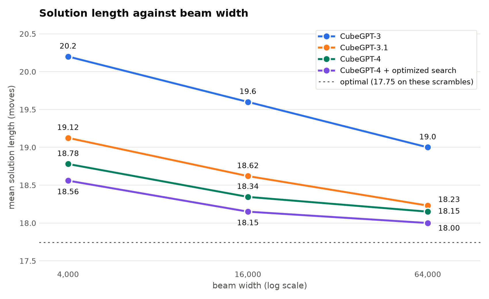
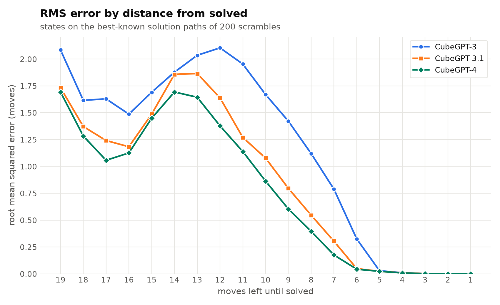
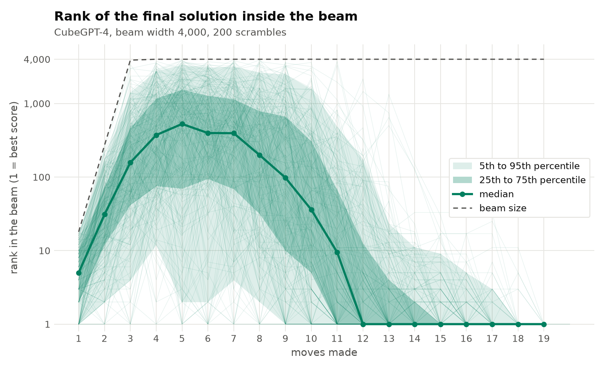

# CubeGPT-4: Scaling up Transformer-based Rubik's Cube Solvers
A research report about approaching optimality.

## Introduction

Solving Rubik’s Cubes is hard! There are on the order of 10^19 possible Rubik’s Cube states, and only one winning state. Any standard algorithms like A* search, which explore a significant fraction of possible states, are rendered useless. We have to prune trees extremely aggressively, which is where an estimator trained via machine learning comes in.

https://github.com/user-attachments/assets/11d65675-f1da-4a33-9670-15d962b7a386

So does the AI work? Yes! We're able to achieve a model that beats cubes in, on average, **18.00** moves, less than a quarter of a move worse than the theoretical optimal. With faster search, we can solve most cubes in under 4 seconds with average length **18.56** moves. 

https://github.com/user-attachments/assets/dec1678b-9dfd-43b1-b308-2db92b75032a

### Previous Work

This project builds significantly off of the DeepCubeA and CayleyPy papers. It also builds off <a href=https://github.com/stanleytheli/cubegpt>my previous work on training transformers to solve Rubik’s Cubes, CubeGPT-2</a>. Essentially, the strongest model I tested in solving was CubeGPT-2g-PFT, an out-of-the-box transformer architecture running the GeLU activation trained over 25M samples. The strongest model I trained was CubeGPT-CLS-t154m-PFT, which was a classifier model trained on just over 200M samples. 

In this work, CubeGPT-3 and CubeGPT-4, I improve the model architecture and training pipeline, and devote more compute to larger-scale experiments, getting significantly closer to optimality. We get multiple step improvements as a result. Experiments also reveal more about the nature of training Rubik's Cube models.

## Training

### CubeGPT-2 → CubeGPT-3:

CubeGPT-3 updates over CubeGPT-2 using more modern research and explicitly implements the symmetries of the Rubik's Cube.

In order of being added:

* **GPU optimization**: Moving the data pipeline onto the GPU sped up training ~2x and inference ~3x. TF32 matmuls add another ~1.5x for very little loss in quality.
* **No classifier token**: We now apply a linear layer over the whole token sequence instead of predicting from a special 'cls-token'.
* **Canonicalization**: Rotating or mirroring a cube and relabeling the colors gives the same puzzle. That is 48 symmetries, which we enforce with a cheap preprocessing step.
* **Gated MLP**: f(x) = C(Ax * SiLU(Bx)) instead of f(x) = B(GeLU(Ax)).
* **Mixture of Experts (MoE)**: Deepseek V3-style, 8 experts with 1 active, using explicitly tuned expert biases for load balancing. This adds capacity while holding the number of active parameters the same as CubeGPT-2.

Trained for 307M samples, this is CubeGPT-3-8A1-t300m or just CubeGPT-3.

### CubeGPT-3 → CubeGPT-3.1

CubeGPT-3.1 is the same architecture as CubeGPT-3, but with a better learning rate scheduler. We find that the LR scheduler for CubeGPT-3 was significantly too aggressive, cutting LR too early for improvements to "settle in". 

We implement an explicit LR schedule which warms up, holds a high learning rate (5.6e-4) for the most of the run, then cools down to zero near the end. Holding a higher LR allows us to train on higher batches better, so we also increase batch size to 1024. 

That alone takes the loss from 0.1308 to 0.1073, and significantly improves all metrics.

### CubeGPT-3.1 → CubeGPT-4

We notice two problems with CubeGPT-3.1: (1) the MoE routing is very noisy which causes routing to change very fast in training, and (2) several of the layers are effectively unused. We measure this by ablating the layers, removing them replacing with just their average value, then measuring the loss. In CubeGPT-3.1, the first layer's MoE FFN can be removed while not impacting the loss at all, and several more have less than 5% impact.

We introduce the CubeGPT-4 architecture which stacks attention layers and then puts the FFNs after, in series. We get rid of MoE because the routing changing so fast indicated that expert specialization wasn't helping. Experiments show that these architectures are able to achieve equal and lower loss than the standard transformer. These architectures also run significantly faster because they less active parameters and no MoE routing overhead. We see that CubeGPT-4 makes more usage of all of its layers.

We also optimize the training pipeline, introducing prenorms instead of postnorms, and using AdamW with hyperparameters more suited to high learning rates.

We also train for much longer, with a more explicit learning rate schedule. The first 230M samples are at 4e-4, the next 300M at 2e-4, the next 300M at 1e-4, and then the final stretch of 300M where the learning rate linearly decays to zero.

The result is a model with a fifth of the parameters of CubeGPT-3.1 that is better on every metric.

|Model|Training Examples (Millions)|Mean Squared Error|Within-3-Accuracy| Within-4-Accuracy|Accuracy (When rounding to nearest int)|
| --- | --- | --- | --- | --- | --- |
|CubeGPT-2 | 26.2 | 4.70 | 82.49% | 91.37% | 37.88% |
|CubeGPT-CLS-t154mPFT | 204.8 | 4.30 | 83.96% | 92.40% | 42.50% |
|CubeGPT-3 | 307.2 |  4.01 | 84.8% | 93.0% | 44.9%
|CubeGPT-3.1 | 307.2 |  3.01 | 88.83% | 95.56% | 50.91%
|CubeGPT-4 | 1,152 | **2.68** | **90.22%** | **96.30%** | **53.84%**

This table is against random scrambles. The benefit is a lot of data, and matching the training distribution, but this is low quality data.

We can generate higher quality data using our own model to solve the cubes, giving labels that are much closer to the truth. Technically this biases any metric toward the model used to solve it, but in practice this bias is not noticeable; for instance when we generate this data using CubeGPT-3's solves, the better models still score better. The sample size is just over 3600 states (technically, we should also note these aren't statistically independent).

|Model|Mean Squared Error|Accuracy (When rounding to nearest int)|Within-1-Accuracy|Within-2-Accuracy|Within-3-Accuracy|Within-4-Accuracy|
| --- | --- | --- | --- | --- | --- | --- |
|CubeGPT-3 | 1.86 | 50.12% | 65.22% | 85.24% | 94.71% | 98.64% |
|CubeGPT-3.1 | 1.16 | 59.07% | 73.64% | 91.00% | 97.73% | 99.64% |
|CubeGPT-4 | **0.92** | **61.31%** | **77.29%** | **92.97%** | **98.64%** | **99.97%** |

## Solving

To solve a cube we run a beam search guided by the model's distance estimates, keeping the best `width` states at every step. MAO is "moves above optimal": the average solution length minus the average optimal solution length. For CubeGPT-3.1 and CubeGPT-4, we get optimal data from running the [vcube](https://github.com/Voltara/vcube) solver, giving an average of 17.745. The test set for width 64000 is smaller and gave an average of 17.78. The older rows use the usual estimate of 17.7.

|Model| Width | Solve Rate | Average Moves | MAO |
| ---| --- | --- | --- | --- |
|CubeGPT-2| 4000 | 99% | 21.1 | 3.4 |
|CubeGPT-3| 4000 | 99% | 20.2 | 2.5 |
|CubeGPT-3| 16000 | 100% | 19.6 | 1.9 |
|CubeGPT-3| 64000 | 100% | 19.0 | 1.3 |
|CubeGPT-3.1| 4000 | 100% | 19.13 | 1.38 |
|CubeGPT-3.1| 16000 | 100% | 18.62 | 0.88 |
|CubeGPT-3.1| 64000 | 100% | 18.23 | 0.45 |
|CubeGPT-4| 4000 | 100% | 18.78 | 1.04 |
|CubeGPT-4| 16000 | 100% |18.35 | 0.60 |
|CubeGPT-4| 64000 | 100% | 18.15 | 0.37 |

The CubeGPT-3.1 and CubeGPT-4 rows use the same 200 random scrambles (100 at width 64000). The CubeGPT-2 and CubeGPT-3 rows are from earlier runs on different scrambles.

Better models bring significant gains. CubeGPT-4 at width 4000 outperforms CubeGPT-3 at width 64000, CubeGPT-4. At width 4000, CubeGPT-4 takes less than five seconds per solve. Scaling is also buying less and less, even on the log scale, because we are bumping up against the theoretical optimal average of 17.7. Earlier models failed to solve small numbers of cubes; the new models are more reliable and do not fail to solve in our experiments.

How calibrated are our models? Measured against our best found solutions, CubeGPT-4 comes out clearly ahead in RMS error. Perhaps surprisingly or not, difficulty is not monotonic; it is hardest to tell around move 14. 

### Optimized beam search

The plain beam search algorithm can be significantly optimized upon to get us much more efficient solutions. 

**De-duplication.** Different move orders often reach the same cube state: `U D` and `D U`, for example. We remove these to allow more room for unique states. This also makes it much faster because less redundant model calls are made.

**Width scheduling.** We widen the early steps and thin down the later steps. This keeps total compute essentially constant (or faster), and gives more room for solutions to not be cut out early. 

This is a graph of the rank of the final solution versus the progress into the solution. A few moves in, most solutions are under rank 1000, meaning the model recognizes them as top 25% candidates. But a lot are also in the upper end, some reaching dangerously close to 4000 (which would get them cut out). This happens mostly within the first 10-12 moves; after that, a lot of width is being *wasted* when the network has already identified the solution and ranks it in the top 10-100. This motivates width scheduling.

We choose the following widths: 
|Compute (same as flat width)| Moves 1-8 | Moves 9-10 | Move 11 | Move 12 | Move 13 | Move 14 | Moves 15+ |
| --- | --- | --- | --- | --- | --- | --- | --- |
| 4000 | 6000 | 6000 | 6000 | 3000 | 1500 | 750 | 500 |
| 16000 | 32000 | 32000 | 4000 | 1000 | 250 | 100 | 100 |
| 64000 | 128000 | 64000 | 8000 | 1000 | 100 | 100 | 100 |

Optimized beam search is significantly better: at effective width 16000, it beats plain beam search at width 64000. Improvements are consistent across effective widths. In fact, across our test set, they have only improved solutions and never degraded them, which we take as a moderately strong sign of robust improvement.

|Effective width| Search | Average Moves | MAO | Solved Optimally | Optimal + 1 | Seconds per Solve |
| --- | --- | --- | --- | --- | --- | --- |
| 4000 | Plain | 18.78 | 1.04 | 33.0% | 36.0% | 4.6 |
| 4000 | Optimized | **18.56** | **0.82** | **40.0%** | 40.5% | **3.6** |
| 16000 | Plain | 18.35 | 0.60 | 51.0% | 38.5% | 16.6 |
| 16000 | Optimized | **18.15** | **0.41** | **65.0%** | 29.5% | **13.4** |
| 64000 | Plain | 18.15 | 0.37 | 66.0% | 31.0% | 63.9 |
| 64000 | Optimized | **18.00** | **0.22** | **80.0%** | 18.0% | **40.0** |

Our models are approaching optimality. With less than 4 seconds of search, we are optimal 40% of the time and within 1 move of optimal 80%. With 40 seconds of search, we are optimal 80% of the time and within 1 move of optimal 98%. 

## More Solve Videos

https://github.com/user-attachments/assets/11852e10-dcf8-46cf-834f-4310f91a1378

https://github.com/user-attachments/assets/5a294b09-61b6-42ef-839e-f9450f000fe7